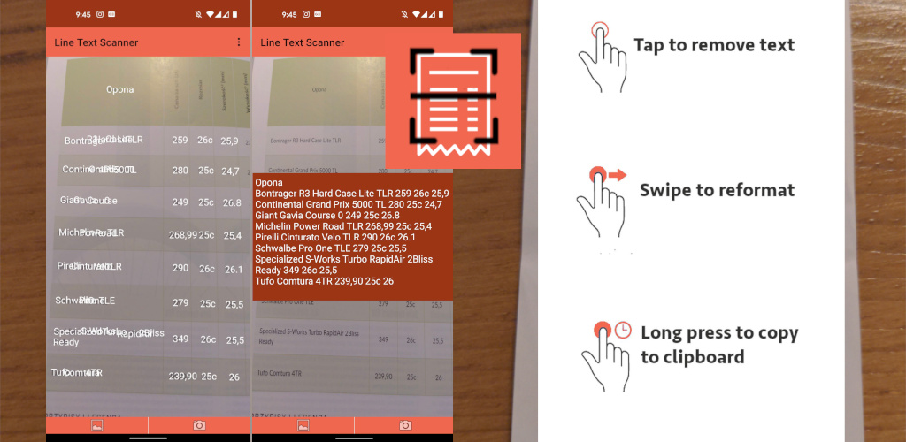

# Line Text Scanner
Android app to scan text from tables using OCR library. It implements an algorithm that prefers horizontal lines so it will output a line of text for an entire row of a table instead of individual words. It is useful for scanning tables from documents, receipts, and invoices.

Available on Play Store here: https://play.google.com/store/apps/details?id=com.rtstyk.linetextscanner

